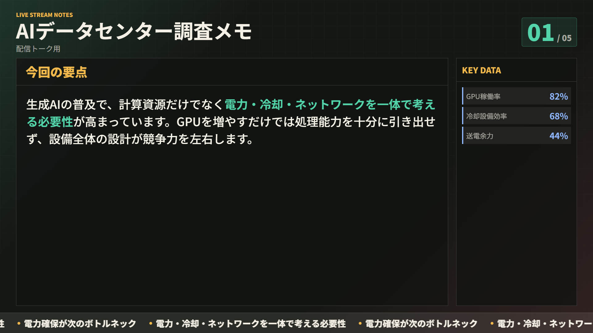
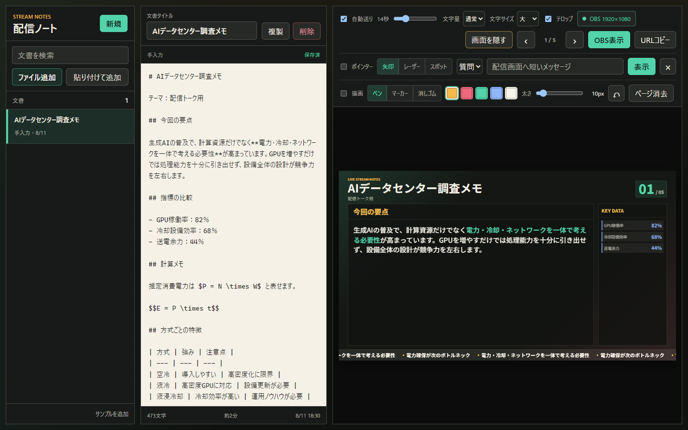

# 配信ノート / Stream Notes

Markdownやテキストを、OBS Studioのブラウザーソースで読みやすい配信画面へ変換するローカルアプリです。AIが出力した文章をそのまま貼り付け、見ながら話す用途を中心に作っています。





## 主な機能

- テキスト入力、クリップボード貼り付け、複数の`.md`／`.txt`ファイル追加
- 文書ライブラリーへの自動保存、検索、複製、削除
- Markdown見出し、箇条書き、表、数値グラフのスライド化
- ASCII図、コードブロック、長い表や図の縦スクロール
- KaTeXによるインライン数式と別行立て数式
- AI出力で改行やエスケープが入ったLaTeX数式の自動整形
- 文字サイズ、表示密度、自動送り、循環テロップ
- 前後ボタン、ページスライダー、番号指定によるページ移動
- OBSと同期するポインター、レーザー、スポットライト、メッセージ
- ペン、マーカー、消しゴム、取り消し、ページ単位の描画消去
- 1920x1080を基準にしたOBS向け表示

## Windows版を使う

1. [Releases](../../releases)またはBOOTHからWindows版ZIPをダウンロードする
2. ZIPを任意のフォルダーへ展開する
3. `start-stream-notes.cmd`をダブルクリックする
4. 操作画面の「URLコピー」を押す
5. OBS Studioで「ブラウザ」ソースを追加し、URLを貼り付ける

OBSブラウザーソースの推奨設定は、幅`1920`、高さ`1080`、FPS`60`です。アプリを終了するときは`stop-stream-notes.cmd`を実行します。

デスクトップへ起動アイコンを作る場合は、`install-desktop-shortcut.cmd`を一度実行してください。

## データと通信

文書は`%LOCALAPPDATA%\StreamNotes\state.json`へ保存されます。アプリを更新して別のフォルダーへ展開しても文書は引き継がれます。旧版の`data\state.json`がある場合は初回起動時に自動移行します。

アプリは`127.0.0.1:4177`だけで動作し、入力文書や利用情報を外部へ送信しません。詳細は[PRIVACY.md](PRIVACY.md)を参照してください。

## ソースから実行する

Node.js 22以降が必要です。

```powershell
npm ci
npm run check
npm run dev
```

操作画面は`http://127.0.0.1:4177/`、OBS表示は`http://127.0.0.1:4177/?view=overlay`です。

Windows向け配布ZIPは次のコマンドで生成できます。

```powershell
npm run release:windows
```

利用者向けの詳しい操作方法は[BOOTH_USER_GUIDE.md](docs/BOOTH_USER_GUIDE.md)にまとめています。
公開前に除外すべき情報は[PRIVACY_RELEASE_CHECKLIST.md](docs/PRIVACY_RELEASE_CHECKLIST.md)で確認できます。

## フィードバック

通常の不具合や機能提案はGitHub Issuesへ送ってください。脆弱性に関する連絡は[SECURITY.md](SECURITY.md)を参照してください。

## ライセンス

配信ノートのソースコードは[MIT License](LICENSE)で公開します。第三者ソフトウェアについては[THIRD_PARTY_NOTICES.md](THIRD_PARTY_NOTICES.md)を参照してください。
